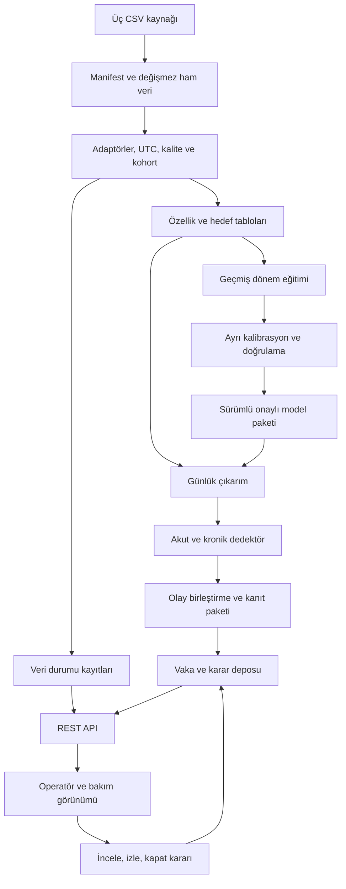

> **ARŞİV — referans alınmaz.** Bu belge PRD v1.0 (15 Eylül 2026) sürümünün kopyasıdır ve geçerliliğini yitirmiştir.
> Gereksinim, eşik, metrik veya karar için kullanılmaz. Arşiv kuralı: [docs/archive/README.md](README.md).

# SilentWatt Teknik PRD

**Sürüm:** 1.0 · **Tarih:** 15 Eylül 2026 · **Durum:** Geliştirme için önerilen teknik sözleşme

**Ürün:** Klima devrelerindeki kalıcı tüketim sapmalarını belirleyen ve bakım ekibine gerekçeli inceleme önerileri sunan karar destek sistemi.

**Ekip reposu:** [BerkeDurdu/SilentWatt](https://github.com/BerkeDurdu/SilentWatt). Repo adresi kullanıcı tarafından bildirilmiştir. Bu belge repo içeriğinin, branch yapısının veya mevcut kodun incelendiği anlamına gelmez.

**Veri kökü:** `SilentWatt/dataset/`. **Ekip:** Bir UX/UI ve frontend geliştiricisi, iki backend/AI geliştiricisi.

## 0. Belgenin statüsü ve kararların okunması

Bu PRD, veri girişinden kullanıcı kararına kadar MVP'nin ürün ve teknik sınırlarını tanımlar. Bölüm 4'teki dosya bulguları dışında anlatılan işlevler geliştirilmiş veya ölçülmüş sonuçlar değil, uygulanacak tasarımdır.

| Etiket | Anlamı |
|---|---|
| **[VERİDE DOĞRULANDI]** | 15 Eylül 2026 tarihli yerel dosya taramasında gözlendi. Kapsamı yalnızca taranan dosyalardır. |
| **[KAYNAK]** | Bağlantısı verilen dış teknik dokümantasyon veya araştırma tarafından desteklenir. |
| **[TASARIM KARARI]** | Bu PRD'nin önerdiği uygulanabilir davranış. Bir saha bulgusu değildir. |
| **[HEDEF]** | Henüz ölçülmemiş kabul eşiği veya takvim. Test sonucu ayrıca raporlanır. |
| **[VARSAYIM / AÇIK]** | Doğrulanması gereken bilgi. İlgili kapı kapanmadan buna bağlı iddia yapılmaz. |
| **[TEMSİLİ]** | Açıklama, sözleşme veya demo için oluşturulmuş örnek. |

Etiketsiz normatif ifadeler (“üretir”, “zorunludur”, “yapmalıdır”) **[TASARIM KARARI]** kapsamındadır. Tüm takvim ve performans eşikleri **[HEDEF]** olarak okunur. Bunlar müşteri taahhüdü değildir.

### 0.1 Önceki taslaktan farklar

- Eski `v0.9` belgesindeki 20 hane bilgisi yerine mevcut dosyaların 25 hanelik kapsamı kullanılır. Nihai model kohortu kalite elemesinden sonra belirlenir.
- Ürün, fiziksel arıza nedenini kanıtladığını veya sağlanan ısıl çıktıyı bilmeden gerçek verimi ölçtüğünü iddia etmez.
- Devre ölçümü zorunlu girdidir. Toplam sayaç erişimi, ekipman devresine erişimle eşdeğer değildir.
- Nem, ışınım, cihaz kapasitesi, termostat ayarı, servis kaydı ve saha etiketi mevcut üç dosyada doğrulanmış girdi değildir.
- Konformal kapsama, olay düzeyindeki yanlış alarm oranına veya arıza olasılığına eşitlenmez.
- İlk sürüm, tek klima kanalı ve tek tüketim sapması ailesine odaklanır. Otomatik fiziksel teşhis, servis sevki ve kurtarılabilir tasarruf hesabı sonraki doğrulamayı gerektirir.
- MVP için bulutta toplu işlem ve küçük bir kullanıcı arayüzü seçilir. Uç dağıtım, büyük dil modeli ve belirli hızlandırıcı donanım zorunlu değildir.

### 0.2 Okuma haritası

Ürün ve kapsam için bölümler 1–3; veri için 4–6; ML ve karar mekanizması için 7–10; API ve arayüz için 11–13; işletim, doğrulama ve ekip planı için 14–19 okunmalıdır. Bölüm 20, tek bir vakanın uçtan uca yürüyüşünü gösterir.

## 1. Problem, ürün ve başarı tanımı

### 1.1 Çözülen problem

Bir klima çalışmayı sürdürürken elektrik tüketimi artabilir. Hava sıcaklığı, kullanım değişikliği veya cihaz davranışındaki bozulma aynı gözlemi oluşturabilir. Çok sayıda cihazı yöneten ekip, toplam tüketim grafiğinden hangi devrenin incelenmesi gerektiğini belirlemekte zorlanır.

SilentWatt, devrenin gözlenen tüketimini kendi geçmişi ve dış sıcaklık bağlamında beklenen tüketimle karşılaştırır. Tekil dalgalanmalardan kalıcı sapmaları ayırır. Bir inceleme listesi ve her vaka için kanıt paketi üretir.

**Temel kullanıcı sorusu:** “Hangi klima devresini, hangi kanıta dayanarak incelemeliyim?”

### 1.2 Ürün vaadi ve sınırı

**Ürün vaadi:** Mevcut klima devresi ölçümlerini, gerekçesi ve veri sınırları görülebilen bakım incelemesi önerilerine dönüştürmek.

**Ölçülen şey:** Koşullara göre referans tüketimden sapma. **Doğrudan ölçülmeyen şey:** Soğutma kapasitesi, COP, fiziksel verim kaybı, arıza nedeni ve bakım sonrası kesin tasarruf.

Referans dönem sağlıklı olmayabilir. “Normal” kelimesi uygulamada “seçilen referans davranışı” anlamına gelir. Bilinen arıza etiketi bulunmadığından cihazın sağlıklı olduğunu onaylayan bir ekran üretilemez.

### 1.3 Beklenen değer

Operatör grafik taramak yerine sıralı vakaları inceler. Teknisyen hangi dönemde ve nasıl bir değişim görüldüğünü önceden anlar. Ekip bir kararı sonradan veri ve model sürümüne kadar izleyebilir. Daha az gereksiz inceleme ve enerji tasarrufu, **pilotla sınanacak iş hipotezleridir**; MVP sonucu gibi sunulmaz.

## 2. Kullanıcılar ve kullanım senaryoları

| Persona | Yetki / görev | Çekirdek kullanım |
|---|---|---|
| Operatör / enerji yöneticisi | Vakaları görür, inceleme önerisini kabul eder, izlemeye alır veya kapatır | Haftalık bakım önceliklendirmesi |
| Bakım ekibi / teknisyen | Kanıt paketini ve ilk kontrol önerisini okur | İnceleme öncesi hazırlık |
| Teknik yönetici | Veri işlerini, model sürümünü ve değerlendirme raporunu yönetir | Veri kalitesi ve yayın kontrolü |

**İlk hedef ortam:** Klima devre ölçümü bulunan konut portföyleri veya benzer küçük bina operasyonları. Austin konut verisinden büyük merkezi ticari HVAC sistemlerine genelleme **[VARSAYIM / AÇIK]** kapsamındadır.

**UC-01 — Haftalık inceleme:** Operatör kalite durumunu kontrol eder, sıralı listeden vakayı açar, grafiği ve eksik bağlamı değerlendirir, kararını gerekçesiyle kaydeder.

**UC-02 — Veri yetersizliği:** Veri kesintisinde cihaz “normal” olarak gösterilmez. Kullanıcı ilgili dönemin değerlendirilmediğini ve nedenini görür.

**UC-03 — Tekrarlayan sapma:** Günlük iş aynı kalıcı değişimi yeniden bulduğunda açık vakayı günceller; ayrı bir alarm seli oluşturmaz.

**UC-04 — Pilot geri bildirimi:** Gelecekte teknisyen gerçek sonucu kaydeder. MVP'deki operatörün “incelemeye değer” kararı, doğrulanmış saha arızası etiketi sayılmaz.

## 3. Kapsam ve ekip sahipliği

### 3.1 MVP kapsamı

| Kapsam | MVP davranışı |
|---|---|
| Ekipman | Metadata doğrulamasına bağlı `air1` klima/soğutma devresi |
| Anomali ailesi | Referansa göre kalıcı pozitif tüketim sapması; ani başlangıç ve kademeli başlangıç varyantları |
| Ana çözünürlük | 15 dakika; günlük tamamlanan pencereler üzerinde değerlendirme |
| Ek kanıt | Uygun bir dakikalık veriden çalışma örüntüsü; eksikliği ana tespiti tek başına engellemez |
| Bağlam | Yerel hava dosyasındaki saatlik sıcaklık ve takvim |
| İşletim | Sabit veri setinin gün gün yeniden oynatımı; günlük toplu analiz, haftalık liste |
| Kullanıcı çıktısı | Veri durumu, vaka listesi, detay/kanıt, basit operatör kararı, rapor dışa aktarımı |
| Değerlendirme | Zaman sıralı test, karşılaştırma modelleri, kontrollü sentetik enjeksiyon ve kanıt değerlendirmesi |

**MVP dışında:** Toplam sayaçtan NILM geliştirme, çoklu ekipman teşhisi, gerçek kısa çevrim arızası sınıflandırması, otomatik servis sevki, faturalandırma, dinamik fiyatlandırma, otomatik cihaz kontrolü, saha başarısı garantisi, uç donanım portu ve zorunlu LLM.

### 3.2 Üç kişilik iş bölümü

İsimler atanana kadar aşağıdaki rol kodları kullanılır. İki backend/AI geliştiricisi ortak alanlarda birbirinin değişikliklerini inceler; her teslimin tek bir asıl sahibi vardır.

| Rol | Asıl sorumluluk | Diğer rollerle sözleşmesi |
|---|---|---|
| **A — UX/UI + frontend** | Kullanıcı akışları, tasarım sistemi, erişilebilir grafikler, liste/detay/karar ekranları, frontend testleri | B'nin OpenAPI sözleşmesini tüketir; C ile model belirsizliği ve kanıt dilini doğrular |
| **B — Backend + veri/işletim** | CSV adaptörleri, UTC hizalama, kalite hattı, depolar, iş yürütme, API, durum makinesi, auth ve dağıtım | C'ye sürümlü öznitelik tablosu verir; C'nin çıktı şemasını valide eder; A'ya sabit API ve örnekler sağlar |
| **C — AI/ML + analitik backend** | Kohort kuralları, baseline, kuantil model, kalibrasyon, çift dedektör, sentetik benchmark, imza kuralları ve ML raporu | B'ye Python modülü/CLI ve sürümlü model paketi verir; A'ya grafik anlamlarını ve gösterim kısıtlarını tanımlar |

**Ortak kararlar:** B+C veri kabulü, zaman bölmeleri ve model yayını; A+B karar durumları; A+C açıklama ve belirsizlik dili. Dağıtım operasyonunun sahibi B, bilimsel ölçümlerin sahibi C'dir. Ayrı bir DevOps, QA veya veri mühendisi varmış gibi plan yapılmaz.

## 4. Veri setlerinin sözleşmesi ve doğrulanmış profil

Yerel dosya taramasının ayrıntısı [veri denetim çıktısında](ekler/dataset-audit-2026-09-15.json), tekrar üretim yöntemi [denetim betiğinde](ekler/audit_prd_data.py) saklanır. Hash, satır sayısı, kolonlar, hane bazında doluluk, zaman anahtarı ve seçili kalite kontrolleri bu ekte yer alır. Bu tarama fiziksel cihaz kimliğini veya arıza durumunu doğrulamaz.

### 4.1 Dosya adlarının eşleştirilmesi

| Kullanıcının belirttiği ad | Diskte bulunan dosya | Adaptör |
|---|---|---|
| `1minute_data_austin.csv` | `dataset/1minute_data_austin.csv` | `pecan_1m` |
| `15minutes_data_austin.csv` | `dataset/15minute_data_austin.csv` | `pecan_15m` |
| `open-meteo-30.26N97.69W157m` | `dataset/open-meteo-30.26N97.69W157m.csv` | `open_meteo_csv` |

**[VERİDE DOĞRULANDI]** İkinci dosya diskte `15minute` biçimindedir. Dosyalar yeniden adlandırılmaz. Pipeline dosya yolunu manifestten alır; benzer iki dosya varsa sessizce birini seçmez.

### 4.2 Bir dakikalık elektrik verisi

**Rol:** Günlük çalışma oranı, çalışma süresi ve açılma sayısı gibi destekleyici sinyalleri üretmek; 15 dakikalık ölçümle tutarlılığı incelemek.

**[VERİDE DOĞRULANDI]** Anahtar alanlar `dataid`, `localminute`; seçili ölçüm alanları `air1`, `air2`, `airwindowunit1`, `furnace1`, `furnace2`, `grid`, `solar` ve `refrigerator1`.

**[VARSAYIM / AÇIK]** Güç kolonları kW cinsinden aralık ortalaması, zaman etiketi de aralık başlangıcı olarak yorumlanacaktır. CSV başlığında güç birimi ve zaman aralığı semantiği yazmadığı için bu yorum sağlayıcı veri sözlüğüyle doğrulanmadan fiziksel birim iddiası kesinleşmez. `leg1v`/`leg2v` güç kanalı olarak işlenmez.

Bir dakikalık ortalama, saniye altı geçişleri göstermez. Değişken hızlı klima tek eşikle açık/kapalı olarak ayrılmayabilir. Türetilen çevrim özellikleri “tahmini” etiketi taşır; marka, kapasite veya fiziksel kısa çevrim teşhisi çıkarılmaz.

### 4.3 On beş dakikalık elektrik verisi

**Rol:** Ana modelin hedef tüketim serisi, tahmin/kalibrasyon ve iki dedektörün zaman tabanı.

**[VERİDE DOĞRULANDI]** Anahtarlar `dataid`, `local_15min`. Dosya sırasının kronolojik olduğu varsayılmaz; kaynak satır sırasından bağımsız olarak UTC anahtarıyla sıralanır.

Bir dakikalık serinin ortalamasıyla benzer olması aynı gözlemleri bağımsız veri yapmaz. İki dosyanın aynı hane ve dönemleri eğitim ve test arasında birbirinden ayrılarak veri miktarı yapay biçimde artırılamaz.

**Otoritatif seçim:** MVP hedefi sağlanan 15 dakikalık dosyadır. Bir dakikalık ortalamayla uyuşmazlık varsa otomatik birleştirme veya boşluk doldurma yapılmaz. Sorun işaretlenir. Yeniden örneklenmiş veriyle çalışma, ayrı kaynak sürümü ve yeni değerlendirme gerektirir.

### 4.4 Open-Meteo sıcaklık verisi

**Rol:** Tüketim artışının dış sıcaklık değişimiyle açıklanabilen bölümünü modellemek.

**[VERİDE DOĞRULANDI]** İlk bölüm konum/zaman dilimi metadata'sıdır. Asıl tablo `time,temperature_2m (°C)` başlığından başlar. Parser bu başlığı arar ve metadata'yı ayrı saklar; tüm dosyayı tek homojen CSV tablo sanmaz. Metadata'daki konum `30.263618, -97.69321`, yükseklik `157.0`, UTC farkı `0`, zaman dilimi `GMT` olarak yazılmıştır.

**[VERİDE DOĞRULANDI]** Bu dosyada nem, güneş ışınımı, termostat ve iç sıcaklık alanları yoktur. Bunlar türetilmiş gerçek ölçüm gibi oluşturulmaz. `temperature_2m` çevresel sıcaklıktır; binanın iç sıcaklığı değildir.

**[VARSAYIM / AÇIK]** Dosyanın tam indirme isteği, kullanılan hava modeli ve yeniden analiz sürümü mevcut CSV'den doğrulanmamıştır. Open-Meteo'nun tarihsel servisinin yeniden analiz kullanması, bu dosyanın belirli bir ERA5 sürümünden geldiğini kanıtlamaz. [Open-Meteo tarihsel veri açıklaması](https://open-meteo.com/en/docs/historical-weather-api)

Tüm hanelere aynı konum serisi atanması MVP varsayımıdır. Hanelerin gerçek koordinatları ve mikroiklim farkları bu dosyalarda doğrulanmamıştır. Tarihsel hava verisiyle çevrimdışı başarı, canlı hava verisinin gecikmesini ve kalitesini doğrulamaz.

### 4.5 Tarama sonuçları

**[VERİDE DOĞRULANDI]** Aşağıdaki sayılar dosyalardaki satırlar ve parse edilmiş UTC anahtarlarından hesaplandı. Tam yılın başlangıç/bitişinin bulunması, aradaki her ölçümün dolu olduğu anlamına gelmez.

| Ölçüt | 1 dakika | 15 dakika | Hava |
|---|---:|---:|---:|
| Veri satırı | 13.100.539 | 873.286 | 8.760 |
| Veri tablosu kolon sayısı | 79 | 79 | 2 |
| Tekil hane | 25 | 25 | Tek konum |
| İlk UTC zaman | 2018-01-01 06:00 | 2018-01-01 06:00 | 2018-01-01 00:00 |
| Son UTC zaman | 2019-01-01 05:59 | 2019-01-01 05:45 | 2018-12-31 23:00 |
| Tekrarlanan hane-zaman / hava zaman anahtarı | 0 | 0 | 0 |
| Parse edilemeyen zaman | 0 | 0 | 0 |
| Yıllık beklenen hane-zaman çizelgesinde bulunmayan slot | 39.461 | 2.714 | Saatlik çizelgede 0 |
| `air1` değeri bulunan hane | 24 | 24 | Uygulanmaz |
| Dolu `air1` ölçümü | 12.496.269 | 833.032 | Uygulanmaz |

Yıllık elektrik slot paydası UTC `[2018-01-01 06:00, 2019-01-01 06:00)` için hane başına 525.600 dakika veya 35.040 çeyrek saattir. Bulunmayan satır sayıları, mevcut satırlardaki kanal bazlı null sayılarına ek bir eksiklik türüdür.

Her iki elektrik dosyasında `air2` iki hanede, `airwindowunit1` bir hanede, `furnace1` 24 hanede, `furnace2` üç hanede, `grid` 25 hanede ve `solar` 20 hanede en az bir değer içeriyor. Bu sayılar cihazın sürekli ölçüldüğünü veya fiziksel olarak tam olarak ne olduğunu kanıtlamaz.

Hava serisi saatlik ve sıcaklık sütununda null yok. Dosyada gözlenen sıcaklık aralığı **−7,2 ile 41,2 °C**. Yerel dosya, elektrik döneminin son UTC günü olan 1 Ocak 2019'daki **00:00–05:59** bölümünü karşılamıyor. Saat eşleştirme kuralında bu altı saat `weather_missing` olur; 31 Aralık 2018 yerel günü günlük kapsama kapısını geçmeyebilir. Önceki sıcaklığı taşımakla eksik gizlenmez.

**Çözünürlük örnek doğrulaması:** Yalnızca `dataid=661` için tam yıl boyunca 15 geçerli dakikası bulunan kutular karşılaştırıldı. `air1` için **34.699** eşleşmiş kutuda, sol kapalı UTC çeyrek saatlik 1 dakika ortalaması ile verilen 15 dakika değeri arasındaki en büyük mutlak fark yaklaşık **0,000467 ham birim**. Bu, bu hane ve kanal için yuvarlamayla uyumlu bir ortalama ilişkisini destekler; tüm hanelerin veya fiziksel kW biriminin doğrulanması değildir.

**Kalite bulguları:** `air1` en küçük değerleri 1 dakikada −0,264, 15 dakikada −0,064 ham birim. `furnace1` için `abs(value)>20` tarama koşulunu sağlayan 15 dakika kaydı beş adet ve `dataid=9019` hanesinde. Bir dakikada aynı tarama koşulu üç hanede toplam 59 kayıt buldu. “20” fiziksel cihaz sınırı değil, bu denetimin araştırma filtresidir. Sensör/ölçek/işleme nedeni doğrulanmamıştır.

**İlk aday listesi:** Tam yıllık `air1` doluluğu ≥%95 ve dolu `air2` olmaması kuralında 21 hane var. `airwindowunit1` ölçülen `5746` da dışlandığında **20 aday** kalır: `661, 1642, 2335, 2361, 2818, 3039, 3456, 3538, 4373, 4767, 6139, 7536, 7719, 7800, 7901, 8156, 8386, 8565, 9019, 9160`. Bu, yalnızca ön eleme sonucudur; fiziksel eşleme ve dönem kalite kapıları henüz geçilmemiştir.

### 4.6 Üç kaynağın birlikte kullanılması

1. Elektrik dosyalarındaki zaman damgaları kendi UTC ofsetleriyle UTC'ye çevrilir. Takvim özellikleri için `America/Chicago` kullanılır. Sabit `-06:00` ofseti tüm yıla uygulanmaz.
2. Hava tablosu metadata gereği UTC kabul edilir. 15 dakikalık `t` başlangıcına `floor_hour(t)` anahtarındaki sıcaklık bağlanır. Hava satırı yoksa önceki saatten sınırsız ileri taşıma yapılmaz.
3. Hedef tablo `household_id + circuit + ts_utc` anahtarında tekildir. Hava birleşimi çoktan-bire olur. Birleşim satır sayısını artırırsa iş durur.
4. Bir dakikalık özellikler `[t,t+15 dakika)` veya tamamlanmış yerel gün üzerinden çıkarılır. Aynı aralığın çalışma süresi, o aralığı tahmin eden modele girdi olarak verilmez; tespit sonrası kanıt olarak kullanılır. Geçmiş özelliklerde bitiş zamanı tahmin kesiminden önce olmalıdır.
5. Bir hane-gün kararı yalnızca o ana kadar tamamlanmış ölçümlerden üretilir. Tarihsel yeniden oynatımın kesim zamanı loglanır. Gelecekteki satır, gün veya test dönemi hiçbir öğrenme adımına girmez.

**Tamamlayıcılık:** 15 dakika “ne kadar bekliyorduk?”, sıcaklık “hangi dış koşullarda?”, 1 dakika “tüketim örüntüsü nasıl değişti?” sorusunu destekler. Üçü birlikte fiziksel arıza nedeni veya sağlanan soğutma miktarı vermez.

## 5. Veri kalite kapıları ve kohort seçimi

### 5.1 Kanonik ölçüm

```text
reading_15m:
  dataset_version, household_id, circuit_code, ts_utc
  interval_seconds=900, power_kw nullable
  quality_status, quality_reasons[], source_file_hash, source_row

signature_1m_daily:
  dataset_version, household_id, circuit_code, local_date
  expected_minutes, valid_minutes, estimated_on_minutes nullable
  estimated_starts nullable, mean_on_power_kw nullable
  extraction_version, quality_reasons[]

weather_hourly:
  weather_version, location_id, ts_utc, temperature_c nullable
  source_file_hash, source_metadata
```

`power_kw` alanı, birim doğrulama kapısı geçtikten sonra yayınlanır. Ham sayı bundan önce `raw_value` ve `unit_status=unverified` ile saklanır. `grid`, PV nedeniyle net alışverişi temsil edebilir; negatif değer otomatik cihaz arızası sayılmaz. Devre envanteri bilinmeden `grid = tüm cihazların toplamı` kuralı uygulanmaz.

### 5.2 Kalite kararları

| ID | Durum | Zorunlu davranış | Sahip |
|---|---|---|---|
| DQ-01 | Eksik zorunlu kolon / bozuk zaman | Kaynağı reddet, açık hata ve satır sayısı üret | B |
| DQ-02 | Aynı anahtar, aynı ölçüm | Tekilleştir ve sayacı raporla | B |
| DQ-03 | Aynı anahtar, farklı ölçüm | Çatışmayı karantinaya al; son satırı sessizce seçme | B |
| DQ-04 | Hanede kanal bütünüyle boş | `unobserved_channel`; cihaz yokluğu veya sıfır tüketim çıkarma | B+C |
| DQ-05 | Kanal mevcut, bazı aralıklar boş | Beklenen zaman çizelgesinde açık eksik olarak tut | B |
| DQ-06 | Uç / negatif güç | Kanal bazında eşik ve gerekçeyle şüpheli işaretle; hamı koru | C |
| DQ-07 | Sabit ölçüm | Sıfır/off dönemlerini ayır; tekrar tek başına arıza kanıtı değildir | C |
| DQ-08 | Hava eksik / desteklenmeyen koşul | İlgili pencereye `insufficient_data` veya `out_of_support` üret | B+C |
| DQ-09 | 1 dakika kanıtı eksik | Ana tespit uygunsa sürdür; çalışma imzasını `unavailable` göster | B+C |
| DQ-10 | Çözünürlükler uyuşmuyor | Karşılaştırma raporu üret; kaynakları sessizce ikame etme | B+C |

MVP varsayılanında hedef güç ve çevrim sinyali interpolasyonla doldurulmaz. Boşlukta olay birikimi ilerletilmez. Bu tercih, uydurulmuş çevrim ve enerji hesabını önler. İleride imputasyon denenirse yalnızca ayrı deneyde, imputasyon bayrağı ve etki raporuyla kabul edilir.

### 5.3 Kohort kabulü

**[HEDEF]** İlk aday seçiminde `air1` için tam yıllık beklenen slotların en az %95'inde ölçüm, ayrıca MVP referans/kalibrasyon/test dönemlerinde ayrı ayrı yeterli kapsama aranır. Yıllık oran tek başına yeterli değildir.

Kapsama paydası dosyadaki satır sayısı değil, seçilen UTC aralığındaki beklenen tekil slot sayısıdır. Kayıt bulunmayan zamanları bu şekilde yakalarız. UTC'de aralık üretip yerel güne dönüştürürüz; yaz saati geçiş günlerini zorla 96 çeyrek saate veya 1.440 dakikaya eşitlemeyiz.

**İlk kohort politikası:** `air2` veya `airwindowunit1` ölçümü bulunan haneler çoklu soğutma belirsizliği nedeniyle ilk kohorttan çıkarılır. Kanalın fiziksel anlamı ve yeterli çalışma örneği ayrıca incelenir. Kohort CSV/JSON çıktısı, her dahil/hariç kararının nedenini saklar. “Boş air2 = kesin tek klima” çıkarımı yapılmaz.

**[HEDEF]** Bir yerel günün günlük tespitinde en az %95 geçerli hedef+sıcaklık slotu gerekir. Toplam enerji karşılaştırması yalnızca eşleşen geçerli slotlarda yapılır. Eksik aralıklar için tam günlük enerjiye ölçekleme yoktur. 1 dakika çalışma özellikleri aynı kapsama kapısından geçer; boşluk üzerinden döngü birleştirilmez.

## 6. Mimari ve uçtan uca modül sözleşmeleri

### 6.1 Dağıtım yaklaşımı

**[TASARIM KARARI]** Tek deploy edilebilir backend içinde ayrı Python modülleri, bir toplu iş süreci, bir API ve bir frontend. Mikroservis, mesaj broker'ı ve Kubernetes MVP bağımlılığı değildir. B iş yürütme ve depoyu; C analitik modülleri sahiplenir.

Önerilen yığın: Python veri/ML modülleri, FastAPI/Pydantic tabanlı API, Parquet ölçüm/özellik dosyaları, PostgreSQL vaka deposu, React+TypeScript frontend ve Docker ile tekrarlanabilir ortam. Sürümler yeni repoda uyumluluk kontrolü sonrasında kilitlenir; burada kurulu oldukları iddia edilmez.

Huawei Cloud eşleştirmesi: OBS kaynak/türetilmiş veri ve model dosyaları, ModelArts eğitim işleri, ECS günlük analiz/API/frontend servisi. Küçük PostgreSQL MVP'de ECS üzerinde çalışabilir; üretimde yönetilen veritabanı ayrı karardır. ModelArts veri ve çıktı için OBS desteği sağlar; ECS uygulama çalıştırır. [ModelArts](https://support.huaweicloud.com/intl/en-us/develop-modelarts/develop-modelarts-0006.html), [ECS](https://support.huaweicloud.com/intl/en-us/productdesc-ecs/en-us_topic_0013771112.html)

Hesap erişimi/bütçe hazır değilse aynı süreç yerel Docker ortamında çalışır. Bulut doğrulaması bu durumda tamamlanmış sayılmaz. Ham veri yüklemesi veri kullanım hakkı kontrolüne bağlıdır; donanım/konum seçimi mevzuat uyumu garantisi gibi yazılmaz.



### 6.2 Modüller ve teslim sınırları

| ID | Girdi | İşlem ve neden | Çıktı | Sahip |
|---|---|---|---|---|
| M01 | Dosya manifesti | Hash/şema doğrula, kaynak sürümü oluştur | `dataset_manifest` | B |
| M02 | Ham CSV | Zaman normalize et, tekilleştir, kalite işaretle | `readings`, `weather`, kalite raporu | B |
| M03 | Kanonik veri | Kohort seç, sıcaklık bağla, geçmiş özellik çıkar | `feature_table`, `cohort_manifest` | B+C |
| M04 | Eğitim bölmesi | Baseline ve kuantil adaylarını eğit | Model adayları ve eğitim raporu | C |
| M05 | Kalibrasyon/geliştirme bölmesi | Bant düzelt, dedektör ayarlarını seç, paketi kilitle | `model_bundle`, `detector_config` | C |
| M06 | Günlük özellik + paket | Gerçekleşeni kullanmadan önce kuantilleri hesapla | `prediction_batch` | C |
| M07 | Tahmin + gerçekleşen + önceki durum | Kalıcılık/eğilim ve veri kapıları | `candidate_event`, yeni dedektör durumu | C |
| M08 | Aday + imza + eski vakalar | Vaka birleştir, kanıt ve öneri oluştur | `case`, `evidence_snapshot` | B+C |
| M09 | Vaka deposu | Sırala, filtrele, kararları işle | REST ve rapor | B |
| M10 | REST cevapları | Grafik ve karar akışı | Kullanıcı görünümü | A |
| M11 | Gerçek test + sentetik varyantlar | Olay eşleştirme ve deney raporu | `evaluation_report` | C, B entegrasyon |

Başarısız modül sonraki aşamaya boş başarılı çıktı vermez. Dosya/iş bazındaki sonuç `succeeded`, `partial` veya `failed` olur. `partial` işte yalnızca geçerli hane-dönemler yayınlanır ve kapsam kullanıcıya gösterilir.

## 7. ML tasarımı ve kalibrasyon

### 7.1 Tahmin görevi

Her uygun çeyrek saat için `y_t = air1` aralık ortalama gücü tahmin edilir. Beklenen medyan ve alt/üst kuantiller üretilir. MVP günlük geriye dönük izleme yapar; hava tahmini ile geleceğin yükünü tahmin etme başarısı iddia etmez.

**Model girdileri:** Dış sıcaklık, yalnızca geçmişe bakan sıcaklık ortalamaları, yerel saat/hafta günü/mevsim, hane kimliği ve eğitimden hesaplanan ölçek bilgisi. Akut modelde önceki gün tüketim özellikleri kullanılabilir. Kronik referansta güncel güç ve güncel çalışma süresi kullanılmaz; bunların bozulmayı beklentiye taşıması engellenir.

**Baseline B0:** Eğitim döneminden sıcaklık dilimi ve yerel saat grubu medyanı/kuantilleri; az örnekli gruplarda eğitim verisinden tanımlı geri dönüş. **Aday B1:** Kuantil kayıplı gradient boosting. Küçük veri ve ekip için ilk model ailesi budur. [Scikit-learn örneği](https://scikit-learn.org/stable/auto_examples/ensemble/plot_gradient_boosting_quantile.html)

TFT, embedding, derin ağ ve GPU ancak baseline'a göre ölçülmüş kazanım varsa eklenir. Hane kimliği yeni hanede kendiliğinden genelleme sağlamaz; yeni hane `calibration_pending` olur. İlk MVP test kapsamı eğitimde görülen hanelerdir.

### 7.2 Zaman bölmeleri

**[TASARIM KARARI]** İlk ileri-zaman protokolü, `America/Chicago` yerel tarihleriyle:

| Bölme | Aralık, başlangıç dahil bitiş hariç | Kullanım |
|---|---|---|
| Eğitim | 2018-01-01 – 2018-06-01 | Model, normalizasyon ve çalışma eşiği öğrenme |
| Kalibrasyon | 2018-06-01 – 2018-07-01 | Konformal düzeltme ve artık ölçekleri |
| Geliştirme | 2018-07-01 – 2018-08-01 | Model seçimi, dedektör eşikleri, sentetik geliştirme |
| Kilitli test | 2018-08-01 – 2019-01-01 | Bir kez nihai değerlendirme; hava sınırındaki eksikler hariç |

Bu dönemler yeterli soğutma davranışı içeriyor varsayımı B+C tarafından doğrulanır. Yetersizse değişiklik test açılmadan sürümlenir. İlk test sonuçları görüldükten sonra “daha iyi” tarih arama yapılmaz. Test ayları ve sıcaklık dilimleri ayrı raporlanır; tek kış/sonbahar ortalamasıyla yaz başarısı iddia edilmez.

Geçmiş pencere en çok 7 gün **[TASARIM KARARI]** olacak şekilde sınırlandırılır. Veri başlangıcında geçmişi yetmeyen özellikler `warmup` olarak işaretlenir ve ileri bilgiyle doldurulmaz. Bölme başında geçmiş yalnızca daha önceki gözlemlerden okunabilir; hedef pencereler sınırı geçemez. Overlap içeren örneklerde en az hedef ufku kadar ayırma uygulanır. Aynı kaynak zaman diliminin gerçek, sentetik, 1 dakika ve 15 dakika türevleri aynı bölmede kalır.

### 7.3 Kuantiller ve konformal profil

**[HEDEF]** Başlangıçta `q05`, `q50`, `q95` ve nominal %90 iki taraflı kapsama kullanılır. P10–P90 aralığı %80 nominaldir; isimler karıştırılmaz.

Kalibrasyondan önce kuantiller negatif olmayan hedef alanına kırpılır ve `0<=q05<=q50<=q95` sırası sağlanır. Bu ön işlem eğitim sonrası kalibrasyonda ve çıkarımda aynıdır; sürümlenir. Kalibrasyon skoru `s_i = max(q05_i-y_i, y_i-q95_i)`. `n` kalibrasyon örneğinde `ceil((n+1)*(1-alpha))` sırasındaki skor seçilir; yeterli örnek yoksa profil yayınlanmaz. MVP'de daraltmayı önlemek için `qhat=max(0, seçilen_skor)` kullanılır. Bant `L=max(0,q05-qhat)`, `U=q95+qhat`; alt sınır kırpması yalnızca negatif olmayan kalite-kabul edilmiş `air1` alanına uygulanır.

**[HEDEF]** Hane profili için en az 14 geçerli gün ve 1.000 geçerli çeyrek saat gerekir. Daha az veride başka hane güvenini kopyalamak yerine `calibration_pending` döner. Çoklu hane modeli kullanılabilir; kalibrasyon yeterliliği yine hane bazında kontrol edilir.

Standart konformal garantinin exchangeability varsayımı, bağımlı ve mevsimsel elektrik serisinde otomatik sağlanmaz. Yöntem burada ampirik kapsama kontrolü olarak değerlendirilir. Kapsama, bant genişliği, hane/ay kırılımları birlikte raporlanır. Kapsama oranı fiziksel arıza olasılığı veya olay yanlış alarm garantisi değildir. [CQR araştırması](https://papers.neurips.cc/paper/8613-conformalized-quantile-regression.pdf)

### 7.4 Referans ve güncelleme politikası

Kronik model, eğitim verisi, öznitelik listesi ve kalibrasyonu birlikte dondurulur. “En düşük tüketimli dönem kesin sağlıklıdır” seçimi yapılmaz. Referans, kararlı ve yeterli kapsamlı geçmiş olarak adlandırılır.

Akut yolun uyarlanabilir kalibrasyonu, yalnızca geçmişte tamamlanmış ve kalite kapısından geçen verilerle haftalık güncellenen ayrı profildir. **[HEDEF]** Son 28 uygun gün ve 7 günlük gecikme kullanılır. Açık vakadaki pencereler otomatik referansa eklenmez. Bu seçim kapsamada yanlılık yaratabileceğinden sabit kalibrasyonla ablasyon yapılır. Yeterli geçmiş yoksa son geçerli profil korunur ve yaşı gösterilir.

Kronik referans otomatik güncellenmez. Ekip yeni referans yayınlamak isterse eski sürüm saklanır ve yeni bir karşılaştırma dönemi başlatılır. Veri dışı sıcaklıklar eğitim aralığı/örnek yoğunluğu kuralıyla `out_of_support` işaretlenir; model belirsizliği garanti gibi sunulmaz.

### 7.5 C'nin B'ye teslim edeceği model paketi

```text
model_bundle/
  manifest.json       # model_id, feature_schema_version, code_commit
                      # dataset/split/cohort hashes, runtime versions, seed
  acute_model.*       # izinli yerel format; kullanıcıdan pickle yüklenmez
  reference_model.*
  calibration.json    # hane, pencere, alpha, qhat, model_id
  detector.yaml       # threshold/merge/reset/quality config
  signature_rules.yaml
  evaluation.json
```

`predict(feature_batch, bundle_id) -> prediction_batch` ve `detect(prediction_batch, readings, prior_state, config) -> events, next_state` saf veri sözleşmeleridir. Model yükleyici hash ve şema sürümünü doğrular. Uyumsuz özellik sırası sessiz tahmin üretmez. Artefakt sürümü bilinmeyen vaka yayınlanmaz.

## 8. Anomali tespiti ve olay yaşam döngüsü

### 8.1 Çeyrek saatten günlük karara

Her uygun slotta `r_t = y_t - q50_t` ve `above_upper_t = (y_t > U_t)` hesaplanır. Yerel gün için yalnızca gerçek gözlemi ve geçerli tahmini olan slotların kümesi `V_d` kullanılır:

```text
residual_energy_d = 0.25 * sum(y_t - q50_t, t in V_d)
reference_energy_d = 0.25 * sum(q50_t, t in V_d)
exceedance_share_d = count(y_t > U_t, t in V_d) / count(V_d)
z_d = (residual_energy_d - calibration_daily_median) / robust_scale
```

`robust_scale`, kalibrasyonun günlük artıklarından elde edilen MAD tabanlı ölçektir; sıfır ölçek için eğitim/kalibrasyondan tanımlı pozitif alt sınır kullanılır. Yetersiz ölçek örneğinde dedektör yayınlanmaz. Günlük medyan düzeltmesi yalnızca dedektör içindir, kullanıcıya gösterilen enerji farkını sessizce değiştirmez.

### 8.2 Akut dedektör

Akut modelin günlük `z_d` ve `exceedance_share_d` değerleri birlikte değerlendirilir. **[HEDEF]** Başlangıç ayarı `z_d>2` ve üst bant aşım payı `>0,20` olan iki ardışık geçerli yerel günün sonunda aday oluşturmaktır. Bunlar fiziksel sabitler değildir; geliştirme döneminde alarm bütçesine göre ayarlanıp `detector_config` içinde kilitlenir.

Günlük çalışma nedeniyle “anlık alarm” veya altı saatlik garanti verilmez. `onset_estimate` ilk şüpheli gün, `detected_at` ikinci günün işi tamamlandığı an olarak ayrı saklanır. Kaç gün gerektiği bir kullanıcı mesajı şablonuna sabit yazılmaz; gerçek değer config'ten gelir.

### 8.3 Kronik dedektör

Dondurulmuş referansın günlük standartlaştırılmış artığı için `S_d=max(0,S_(d-1)+z_d-k)` hesaplanır. **[HEDEF]** Başlangıç araması `k=0,5`, `h=5`; aday koşulu `S_d>h` ve son beş geçerli günün en az üçünde pozitif artık olmasıdır. Geliştirmede bu ayar, sabit kural baseline'ıyla aynı alarm bütçesinde karşılaştırılır.

Son 14 takvim gününde en az 10 geçerli gün varsa sağlam eğim ölçüsü ek kanıt olarak hesaplanır. Pozitif eğim, artan sapmayı destekler; p-değeriyle fiziksel arıza doğrulandığı iddia edilmez. Eğim yetersizliği, kalıcı seviye artışını otomatik kapatmaz.

Tekrarlayan aynı gün yeniden işlendiğinde CUSUM ikinci kez güncellenmez. Durum anahtarı `(namespace, household_id, circuit, detector_version, local_date)` ile tekildir.

### 8.4 Eksik veri ve ortak değişimler

Geçersiz gün pozitif/negatif gün sayılmaz. İki gün veya daha kısa boşlukta birikim dondurulur ve belirsizlik işaretlenir; daha uzun boşlukta yeni aday için birikim sıfırlanır **[TASARIM KARARI]**. Açık vaka veri kesintisi nedeniyle “çözüldü” durumuna geçmez.

Aynı gün birçok hanede sapma görülürse `possible_common_context` kanıtı eklenebilir. Küçük portföyde bu işaret, otomatik hava olayı teşhisi veya vakaları topluca silme gerekçesi değildir. İlk MVP'de bu kural yardımcı göstergedir.

### 8.5 Vaka birleştirme

Aynı hane/devrede akut ve kronik adaylar zaman olarak kesişiyorsa tek vakaya bağlanır; `detectors[]` her iki yolu korur. Aynı devrede açık vaka varken yeni pozitif gün, tarih aralığını genişleten sürümlü kanıt üretir.

**[TASARIM KARARI]** Üç ardışık uygun negatif günden sonra sinyal `cleared` olabilir. Bu yalnızca model sinyalinin kalktığı anlamına gelir; onarım doğrulaması değildir. Yeni aday, kapanmış sinyalden üç günden daha sonra başlarsa yeni vaka üretir. Operatör bir vakayı kapatmış fakat aynı sinyal sürüyorsa tekrar açmak yerine “sinyal sürüyor” etiketi korunur; sonraki ayrı olay `related_case_id` ile bağlanır.

## 9. Kanıt, öneri ve önceliklendirme

### 9.1 Bir dakikalık imza çıkarımı

Çalışma eşikleri yalnızca eğitim döneminin dağılımından belirlenir. Açma ve kapama için farklı eşikler (histerezis) küçük gürültüde sahte çevrim oluşmasını azaltır. Eşik yöntemi, birimi ve sürümü kaydedilir. Belirgin çalışma/kapanma ayrımı bulunamayan hane için `signature_unreliable` döner.

Çıktılar: tahmini açık dakika, gözlenen çalışma başlangıçları, açıkken ortalama güç ve tam gözlenen çevrimlerin süresi. Gün başlangıcında zaten açık olan cihaz yeni bir başlatma sayılmaz. Eksik veri veya pencere sınırına denk gelen çevrimler süre ortalamasına tam çevrim gibi katılmaz. Ortalama gücü veya günlük çalışma süresi artan bir devre otomatik “filtre arızası” olarak etiketlenmez.

### 9.2 Sürümlü öneri kütüphanesi

| Örüntü | Destekleyici kanıt | Eksik / çelişen bağlam | Önerilen ilk kontrol |
|---|---|---|---|
| Kalıcı tüketim artışı | Referans üstü enerji ve kalıcılık | Termostat/kullanım bilinmiyor | Ayar ve kullanım değişikliği kaydını kontrol et |
| Uzayan çalışma | Güvenilir 1 dakika çalışma süresi artışı | Cihaz tipi veya iç ortam bilinmiyor | Çalışma programını doğrula, açıklama yoksa teknisyen incelemesi planla |
| Çalışma gücü artışı | Güvenilir açık durum güç farkı | Ölçüm ölçeği/sensör değişimi bilinmiyor | Önce ölçüm ve cihaz değişikliği kaydını kontrol et |
| Veri sorunu | Eksik, çatışmalı veya tutarsız ölçüm | Cihaz durumu çıkarılamıyor | Veri kaynağını incele |

Kütüphane girdisi `rule_id`, `version`, `predicate`, `required_features`, `support`, `limitations`, `first_check` alanlarını taşır. Desteklenmeyen alanlardan kanıt üretilmez. Liste boş olabilir; “neden belirlenemedi” geçerli çıktıdır.

### 9.3 Enerji farkı ve anlamı

Olay penceresindeki aynı geçerli slotlarda `actual_kwh=sum(y)*0.25`, `reference_kwh=sum(q50)*0.25`, `delta_kwh=actual-reference` hesaplanır. `reference_kwh`, çeyrek saatlik medyanların toplamıdır; beklenen değerin veya toplam medyanın matematiksel garantisi değildir. UI bunu “model referansı” olarak adlandırır.

`sum(max(0, y-q50))` yöntemi kullanılmaz; olağan pozitif hataları biriktirerek farkı şişirebilir. Negatif toplam fark teknik çıktıda korunur. Yüzde fark, referans enerji kalibrasyonda belirlenen anlamlı pozitif alt sınırı aşmıyorsa `null` döner. Sıfıra yakın referansta devasa oran gösterilmez.

Çeyrek saatlik kuantil bantlarının toplamı, günlük enerji için %90 güven bandı olarak sunulmaz. Günlük belirsizlik aralığı ayrıca doğrulanmadıysa API `delta_interval_kwh=null` döner. `estimated_savings`, `recoverable_kwh` ve kesin maliyet tasarrufu MVP alanı değildir.

### 9.4 Öncelik sırası

Önce veri yeterliliği ve geçerli model koşulu sağlanır. Sonra açık inceleme vakaları rapor haftası içindeki ortak geçerli pencerede pozitif `delta_kwh` azalan, pozitif gün sayısı azalan ve vaka kimliği artan sırayla sıralanır. `rank_basis` kullanıcıya gösterilir. Haftalık delta ile yaşam boyu delta karıştırılmaz.

“Kanıt yeterli/kısıtlı” etiketinin koşulları açıklanır; bu bir arıza olasılığı değildir. Kötü model/eksik veri vakaları enerji sıralamasına zorla sokulmaz. Maksimum liste boyutu görüntüleme sayfalamasıdır; her hafta yapay olarak 20 vaka doldurulmaz.

### 9.5 LLM sınırı

MVP öneri metnini şablonlarla üretir. LLM sonraki fazda yalnızca yapılandırılmış kanıtı açıklamak veya çelişen kütüphane adaylarını özetlemek için denenebilir. Eşik, hesap, fiziksel neden icadı ve otomatik sevk LLM'ye verilmez. Her sayı hesaplanan alana, her öneri kütüphane sürümüne bağlanır. LLM arızası temel ürünü durduramaz.

## 10. Sentetik deneylerin tasarımı

### 10.1 Amaç ve veri sınırı

Sentetik veri, etiketsiz ölçüm üzerinde başlangıcı ve değişim büyüklüğü bilinen sınamalar oluşturur. Tamamen boş ekipman kolonları gerçek cihaz varmış gibi doldurulmaz. Kaynak elektrik ve hava dosyaları değişmez.

İlk benchmark üç temel senaryo içerir:

| Senaryo | Üretim | Sınanan özellik |
|---|---|---|
| `step_increase` | Önceden belirlenmiş çalışma eşiğinin üzerindeki ölçümü `1+a` ile çarp | Ani başlayan kalıcı artış |
| `ramp_increase` | Aynı ölçümlerde çarpanı zamanla 1'den `1+a`'ya yükselt | Kademeli artış |
| `data_fault` | Kesinti, donma veya hatalı sıçrama oluştur | Kalite kapısının bakım alarmından önce çalışması |

**[TEMSİLİ DENEY IZGARASI]** Şiddet `%5, %10, %20, %30`; süresi `7 ve 14 gün`. Rampa enjekte edilen çalışma gücünün artışıdır; günlük enerjinin mutlaka aynı yüzde artacağı varsayılmaz. Deney gerçek eklenmiş enerji miktarını ayrıca kaydeder. Çevrim uzatma/kısaltma fiziksel ve zaman tutarlılığı gerektirdiği için ilk kabul benchmark'ına dahil edilmez.

### 10.2 İki çözünürlükte tutarlılık

Enjeksiyonun imza üzerinde de gösterileceği pencereler, tam 1 dakika verisi ve doğrulanmış 1m/15m uyumu olan yerlerden seçilir. Enjeksiyon 1 dakika kopyasında yapılır, sentetik 15 dakika hedefi bu kopyadan aynı zaman semantiğiyle türetilir. Kontrol kolu da aynı ham 1 dakikadan türetilir. Orijinal sağlanan 15 dakika ile türetilmiş deney hedefi ayrı `target_source` alanı taşır.

Yalnız 15 dakikalık karşılaştırmada yapılmış bir enjeksiyona, değiştirilmemiş 1 dakikalık imza “sentetik arızanın kanıtı” diye bağlanmaz. Bu deneyde imza özelliği kapalı olarak raporlanır.

### 10.3 Sızıntı ve ölçüm kuralları

- Train/calibration gerçek veriyle kurulur; sentetik örnekler başlangıçta normal davranış modeline karıştırılmaz.
- Geliştirme ve test senaryoları farklı temel pencereler ve seed'ler kullanır. Generator, ayarlar ve seed listesi kilitli test açılmadan hashlenir.
- `scenario_type`, şiddet, enjeksiyon başlangıcı ve etiketler modele özellik olarak verilmez.
- Sentetik türevler `namespace=synthetic:<benchmark_id>` altında yaşar. Gerçek alarmlarla aynı kullanıcı listesine karışmaz.
- Kontrol penceresinde önceden sapma bulunabilir. “Enjeksiyon yok” durumu “fiziksel olarak sağlıklı” anlamına gelmez. Eşleşmiş kontrol/enjeksiyon sonuçları birlikte raporlanır.
- Başlangıç, ilk değişen slot ve algılanabilir pozitif yükün başladığı zaman ayrı saklanır. Cihaz kapalıysa tespit gecikmesi gizlice kısaltılmaz.

Her senaryo kaydı `source_window_id`, `household_id`, `circuit`, `start/end`, `first_modified_at`, `severity`, `injected_delta_kwh`, `generator_version`, `seed`, `split_id`, `target_source` içerir.

## 11. Veri modeli ve backend sözleşmesi

### 11.1 Depolama ayrımı

Yüksek hacimli ham/temiz ölçümler, özellikler ve tahminler bölümlenmiş Parquet dosyalarında tutulur. Bölüm anahtarları `dataset_version/resolution/household_id/month` olur. API tüm 13 milyon satırı taramaz. Düşük hacimli durum ve ilişkiler PostgreSQL'de saklanır.

| Varlık | Anahtar ve zorunlu alanlar | Kısıt / ilişki |
|---|---|---|
| `dataset_version` | id, manifest_uri, file_hashes, schema_version | Hashlenmiş değişmez kaynak tanımı |
| `household` | id, source_dataid, display_timezone | Adres/kişi bilgisi gerektirmez |
| `circuit` | id, household_id, source_channel, mapping_status | `(household_id, source_channel)` tekil |
| `pipeline_run` | id, namespace, dataset_id, as_of, config_hash, status, started/finished | Aynı idempotency anahtarı tek iş |
| `model_bundle` | id, manifest_uri, hash, approved_at, status | Feature/split/cohort/runtime sürümleri |
| `calibration_profile` | id, bundle_id, household_id, valid_from, alpha, qhat | Geçmiş profil değişmez |
| `detector_state` | namespace, circuit_id, detector_version, date, state_json | Aynı gün iki kez birikim yok |
| `data_issue` | id, run_id, circuit_id nullable, interval, reason, counts | Bakım vakasından ayrı |
| `case` | id, namespace, circuit_id, anomaly_family, onset, detected_at, signal_status, review_status, revision | Birleştirme kuralı aynı devrede işler |
| `evidence_snapshot` | id, case_id, run_id, bundle_id, profile_ids, rule_version, metrics, series_uri, limitations | Append-only; her gün yeni snapshot |
| `review_decision` | id, case_id, evidence_id, actor, action, reason, created_at, expected_revision | Operatör değerlendirmesi; fiziksel etiket değildir |
| `field_outcome` | id, case_id, evidence_id, outcome, verified_cause nullable, note | Şema geleceğe ayrılır; MVP saha verisi üretmez |

`signal_status = active | cleared | unavailable`; `review_status = needs_review | inspection_recommended | monitoring | closed`. Bu iki eksen ayrıdır: kullanıcının vakayı kapatması, dedektör sinyalini veya geçmiş kanıtı silmez.

### 11.2 Analitik çıktı sözleşmesi

```text
prediction_batch (Parquet):
  namespace, dataset_version, bundle_id, profile_id, run_id
  household_id, circuit_code, ts_utc, q05, q50, q95, lower, upper
  validity: valid | insufficient_data | out_of_support | calibration_pending
  reason_codes[], feature_schema_version

daily_detection (JSON/Parquet):
  namespace, household_id, circuit_code, local_date, detector_version
  valid_slots, expected_slots, reference_kwh, actual_kwh, delta_kwh
  z_acute nullable, cusum_chronic nullable, exceedance_share nullable
  candidate: boolean, reason_codes[], onset_estimate nullable
  signature_reference nullable, next_state
```

Geçersiz tahminde sayısal sonuçlar `null`, neden kodu zorunludur. NaN/Infinity JSON'da yayınlanmaz. Null değer sıfır olarak çizilmez. Hane, zaman, sürüm veya birim uyumsuzluğu bütün analitik batch'i ya da etkilenen hane bölümünü açık hata ile reddeder.

### 11.3 İş yürütme ve yeniden deneme

`run_key = hash(namespace, dataset_version, bundle_id, config_hash, as_of_date)` tekildir. İşler hane bazında bölünebilir. İş checkpoint'leri ve `detector_state` aynı transaction/commit sınırında ilerler; retry olay veya karar kopyası oluşturmaz.

Tarihsel backfill, ayrı namespace'te sırayla yeniden oynatılır. Sonuç doğrulandıktan sonra görünür rapor sürümü atomik olarak değiştirilir. Geriye dönük iş aktif dedektör durumuna aradan gün eklemez. Geç gelen/düzeltilmiş veri yeni dataset sürümü ve yeni kanıt oluşturur; önceki operatör kararı korunur.

## 12. API, hata ve karar sözleşmeleri

### 12.1 REST uçları

Tüm uçlar `/api/v1` altında, ISO-8601 UTC zaman ve JSON kullanır. B OpenAPI tanımının sahibidir. A bu sözleşmeden tip ve mock üretir. Kaynak dosyaları HTTP ile herkese açılmaz.

| Yöntem / yol | İstek | Cevap / amaç | Yetki |
|---|---|---|---|
| `POST /auth/login` | kullanıcı/parola | Oturum cookie'si; başarısız denemede genel hata ve hız sınırı | Anonim, sınırlandırılmış |
| `GET /auth/me` | Oturum | Kullanıcı ve izinli roller | Oturum sahibi |
| `POST /auth/logout` | Oturum + CSRF | Oturumu sonlandırır | Oturum sahibi |
| `GET /datasets/{id}/quality` | Dönem/hane filtresi | Kaynaklar, uygun haneler, eksik aralıklar ve nedenler | Okuyucu |
| `GET /runs/{id}` | İş kimliği | Durum, ilerleme, tamamlanan/başarısız kapsam | Teknik yönetici |
| `POST /runs` | dataset_id, bundle_id, as_of, namespace | `202`, run_id; kayıtlı manifestten job başlatır | Teknik yönetici |
| `GET /cases` | week_start, timezone, review_status, household_id, cursor, limit | `items`, `next_cursor`, `report_as_of`, quality_summary | Okuyucu |
| `GET /cases/{id}` | Vaka kimliği | Vaka, son kanıt, sınırlamalar, karar geçmişi | Okuyucu |
| `GET /cases/{id}/evidence` | evidence_id opsiyonel | Metrikler, öneriler, kanıt/provenance | Okuyucu |
| `GET /cases/{id}/series` | start, end, resolution | Zaman, gerçek, medyan, alt/üst bant, geçerlilik | Okuyucu |
| `POST /cases/{id}/decisions` | action, reason, evidence_id, expected_revision | Karar kaydı ve yeni revision | Operatör |
| `GET /reports/weekly` | week_start, format=json veya csv | Vaka özeti, kapsam, açıklamalar | Okuyucu |
| `GET /models/{id}/metrics` | Model kimliği | Test ve kalibrasyon raporu, ölçüm kapsamı | Teknik yönetici |
| `GET /health` | Yok | Servisin erişilebilirliği, hassas içerik yok | İzleme |

Liste varsayılan limiti 20, üst sınırı 100 **[TASARIM KARARI]**. `week_start` rapor zaman diliminde pazartesi, aralık `[başlangıç, sonraki pazartesi)` olarak yorumlanır. Gerçek ve sentetik namespace ayrı sayfa/filtre bağlamıdır; yetkisiz kullanıcı serbest namespace seçemez.

`/series` için 15 dakika en fazla 31 gün, 1 dakika en fazla 24 saat **[TASARIM KARARI]**. Uzun grafiklerde açık çözünürlük ve kalite özetiyle downsample edilir. Ortalama alınmış kuantiller yeni kapsama garantisi gibi etiketlenmez.

### 12.2 Vaka yanıtı örneği

Aşağıdaki içerik **[TEMSİLİ]** sözleşme örneğidir; veri setinde bu olay tespit edilmiş değildir.

```json
{
  "case_id": "case-demo-001",
  "namespace": "synthetic:demo-v1",
  "household_id": "661",
  "circuit": "air1",
  "review_status": "needs_review",
  "signal_status": "active",
  "revision": 1,
  "evidence_id": "evidence-demo-001",
  "window": {
    "start": "2018-08-06T05:00:00Z",
    "end": "2018-08-13T05:00:00Z"
  },
  "metrics": {
    "actual_kwh": 84.0,
    "reference_kwh": 70.0,
    "delta_kwh": 14.0,
    "delta_pct": 20.0,
    "delta_interval_kwh": null,
    "valid_slots": 672,
    "expected_slots": 672
  },
  "detectors": ["chronic"],
  "evidence_status": "sufficient_for_review",
  "limitations": ["thermostat_unknown", "cause_unverified"],
  "recommendation": {
    "rule_id": "persistent_excess_v1",
    "first_check": "Termostat ve kullanım değişikliğini doğrulayın."
  },
  "provenance": {
    "dataset_version": "demo-data-v1",
    "bundle_id": "demo-bundle-v1",
    "profile_ids": ["demo-cal-v1"],
    "run_id": "demo-run-001",
    "rule_version": "1.0"
  }
}
```

### 12.3 Karar ve hata davranışı

İzinli kararlar: `recommend_inspection`, `monitor`, `close`, `reopen`. İlki `inspection_recommended`, ikincisi `monitoring`, üçüncüsü `closed`, sonuncusu `needs_review` durumuna geçirir. Yeniden açma yalnızca kapalı vaka için geçerlidir. Her kararda gerekçe, kullanıcı ve görülen `evidence_id` saklanır. Operatör fiziksel servis emrini bu API ile otomatik göndermez.

Yazma isteklerinde `Idempotency-Key` zorunludur. Aynı key ve aynı gövde aynı sonucu verir; aynı key farklı gövdeyle `409` üretir. `expected_revision` güncel değilse `409 revision_conflict` döner. Kanıt güncellendiğinde revision artar; kullanıcı yeni kanıtı gördükten sonra kararını tekrar gönderebilir.

Standart hata zarfı `code`, `message`, `details`, `request_id` taşır. `401` kimlik yok, `403` yetki yok, `404` kaynak yok, `409` çakışma, `422` geçersiz girdi, `503` geçici servis arızası içindir. Geçerli bir vaka içindeki eksik veri, 500 yerine açık `validity/reason_codes` ile döner.

Rapor sorgusu için vaka yoksa `200 items=[]`; henüz analiz yoksa `report_status=not_processed`; analiz yapılamadıysa `report_status=insufficient_data`. Üçü UI'da farklıdır.

## 13. UX/UI ve frontend gereksinimleri

### 13.1 Ekranlar

| Ekran | İçerik | Kullanıcının tamamladığı görev |
|---|---|---|
| Veri ve analiz durumu | Veri sürümü, son iş, tarih kapsamı, uygun hane sayısı, kalite nedenleri | Sonucun hangi veriye dayandığını anlamak |
| Haftalık vaka listesi | Devre/hane, enerji farkı, kalıcılık, öneri, veri yeterliliği ve durum | İncelenecek vakayı seçmek |
| Vaka detayı | Gerçek/referans/bant grafiği, olay zamanı, sıcaklık, 1 dakika ek kanıt, bilinmeyenler | Önerinin gerekçesini değerlendirmek |
| Karar alanı ve geçmiş | İncele/izle/kapat, gerekçe, zaman, kullanıcı, kanıt sürümü | İzlenebilir operatör kararı bırakmak |

Yeni repo kodu incelenmeden mevcut `Website` uygulaması veya framework kullanılmış kabul edilmez. Bu ekranlar repo bağımsız ürün sözleşmesidir.

### 13.2 Gösterim kuralları

- Güç grafiği `kW`, dönem toplamı `kWh`, sıcaklık `°C` birimi taşır; birim doğrulanmamışsa demo bu kısıtı açık gösterir.
- Çeyrek saatlik bant “tahmin aralığı”dır, “cihaz sağlıklı aralığı” veya “arıza güveni” değildir.
- Eksik aralıklar çizgide boşluk olur. Sıfıra çekme veya kesinti üzerinden düz çizgiyle bağlama yoktur.
- “Vaka yok”, “veri yok”, “işlenmedi”, “desteklenmeyen koşul” ve “imza yok” ayrı durumlar olarak tasarlanır.
- Sentetik sonuçlar kalıcı “Sentetik deney” etiketi taşır. Filtreden çıkınca gerçek sonuç gibi kalamaz.
- Grafik renkleri tek anlam taşıyıcısı değildir; lejant, çizgi biçimi ve erişilebilir metin özeti bulunur.
- Ana ekranda toplam enerji farkı, aynı devre ve zamanların birden çok vakada yinelenmesiyle iki kez toplanmaz.
- Kullanıcıya “filtre arızası kesin”, “%90 arızalı”, “garantili tasarruf” mesajı üretilmez.
- İlk kontrol önerisi bakım ekibine bilgi sağlar; teknik olmayan kullanıcıya elektrik panosu müdahale talimatı içermez.

### 13.3 Frontend teslimleri

A ilk iki haftada akış ve örnek veriyle prototip, üçüncü haftada OpenAPI tabanlı mock istemci, sonraki teslimlerde gerçek API entegrasyonu üretir. Grafik bileşenleri önce sıfır/eksik/negatif fark/sentetik/eski veri durumlarıyla hazırlanır. ML bitene kadar frontend'in beklemesi gerekmez.

**[HEDEF]** Beş katılımcıyla beş görevden oluşan kullanılabilirlik kontrolü: veri güncelliğini bul, öncelikli vakayı aç, gerekçeyi açıkla, eksik bilgiyi söyle, izleme kararı bırak. Beş katılımcının en az dördü görevleri yönlendirme almadan tamamlamalıdır. Katılımcı erişimi henüz doğrulanmamıştır. Yalnız üç kişilik geliştirme ekibiyle yapılırsa sonuç iç prova olarak kaydedilir ve hedef kullanıcı doğrulaması sayılmaz.

## 14. Fonksiyonel kabul matrisi

Bu matris geliştirme backlog'una aktarılacak zorunlu izlenebilirlik çekirdeğidir. `P0` MVP için zorunlu, `P1` P0 tamamlandıktan sonra yapılacak iyileştirmedir.

| ID | Gereksinim | Kabul kanıtı | Sahip | Öncelik |
|---|---|---|---|---|
| FR-01 | Üç kaynağı manifestten okuyabilme | Hash/şema raporu ve eksik dosyada açık hata | B | P0 |
| FR-02 | Ofsetli elektrik ve GMT hava zamanını UTC'de eşleştirme | DST ve yıl sınırı fixture testleri | B | P0 |
| FR-03 | Hane/kanal kapsamasını beklenen slotlara göre ölçme | Bilinen boş satır/kolon örneğinde doğru payda | B+C | P0 |
| FR-04 | Boş kanal, veri kesintisi ve gerçek sıfırı ayırma | Ayrı reason code ve UI durumu | B+A | P0 |
| FR-05 | 1m/15m eşleşmesini doğrulama | Kohort bazında karşılaştırma; eksik 15 dakikayı tam gibi saymama | B+C | P0 |
| FR-06 | Sızıntısız özellik ve split üretme | Bölme manifesti, geleceği değiştirince geçmiş tahmin değişmeme testi | C | P0 |
| FR-07 | Baseline ve kuantil adayını karşılaştırma | Aynı cohort/split üzerinde değerlendirme raporu | C | P0 |
| FR-08 | Ayrı kalibrasyon ve kapsama ölçümü | Profil sürümü, hane/ay kapsama ve bant genişliği | C | P0 |
| FR-09 | Akut ve kronik sinyal üretme | Adım/rampa sentetik deneyleri ve durum testi | C | P0 |
| FR-10 | Veri kesintisinde birikimi doğru yönetme | Boşluk senaryosunda otomatik çözüm üretmeme | B+C | P0 |
| FR-11 | Aynı olayları birleştirme ve tekrar işlemde tekillik | İki dedektör + retry aynı vakaya bağlanır | B | P0 |
| FR-12 | 1 dakika çalışma kanıtını kaliteyle sunma | Kesilen çevrim ve cihaz kapalı testi | C+A | P0 |
| FR-13 | Kanıt ve kütüphane tabanlı öneri üretme | Her sayının alanına ve önerinin kuralına izlenebilirlik | B+C | P0 |
| FR-14 | Haftalık sıralı liste ve detay | Filtre/sayfalama/sıra API testi ve UI görev testi | A+B | P0 |
| FR-15 | İncele/izle/kapat kararı ve geçmiş | Yetki, idempotency ve eski revision testi | B+A | P0 |
| FR-16 | Gerçek/sentetik ayrımı | Namespace ve etiketlerin API/rapor/UI'da korunması | A+B+C | P0 |
| FR-17 | Aynı testte olay düzeyi ölçüm | Önceden tanımlı eşleştirme, eşik ve seed raporu | C | P0 |
| FR-18 | Tekrarlanabilir dağıtım ve demo | Yeni ortamda belgeye göre kurulum + aynı vaka | B, A+C destek | P0 |
| FR-19 | Aynı gün birçok hanede sapma işareti | Otomatik kapatma olmadan ortak bağlam alanı | C | P1 |
| FR-20 | İlave model açıklamaları | Atıf/SHAP gibi çıktıların neden kanıtı sayılmaması | C | P1 |

## 15. Doğrulama planı ve başarı ölçütleri

### 15.1 Bilimsel değerlendirme sözleşmesi

Ölçüm birimi yalnızca çeyrek saatlik nokta değildir. Birincil ürün ölçümü **olay ve hane-hafta** düzeyindedir. Sentetik testte aynı hane/devre ve ilgili senaryo penceresinde oluşan ilk yeni vaka bir yakalama sayılır. Tek vaka birden fazla enjeksiyona kredi alamaz. Başlangıçtan önce açık kontrol vakası yeni yakalama sayılmaz; önceki alarm durumu ayrı raporlanır.

Enjeksiyonlar aynı devrede çakışmaz ve aralarında dedektör durumunu sıfırlayacak ayrım bulunur. Tespit gecikmesi `detected_at - injection_start` olarak ölçülür. Rampa için ilk değiştirilmiş aktif slot ve hedef şiddete ulaşılan zaman da raporlanır. Yakalanmayan olaylar gecikme medyanından sessizce çıkarılmaz; recall ve kaçırma sayısı yanında gösterilir.

Kontrol dönemindeki eşleşmeyen alarmlar `unmatched_alarm_rate` olarak adlandırılır. Fiziksel etiket olmadığı için bunun tamamı gerçek yanlış alarm sayılmaz. Tamamen tanımlı sentetik testte “senaryo düzeyinde yanlış alarm” terimi kullanılabilir; sahaya genellenmez.

Test başlangıcındaki dedektör durumu, geliştirme döneminin sonuna kadar yalnızca geçmiş verilerle yürütülmüş durumdur. Sentetik ve eşleşmiş kontrol dalları aynı başlangıç durumunun kopyasından başlar. Her bağımsız senaryo dalı bu kopyayı kullanır; önceki sentetik senaryonun CUSUM'u sonraki senaryoya taşınmaz. Dönem başarısını yapay artırmak için test başında geçmiş açık vakalar sessizce silinmez.

### 15.2 Başlangıç kabul hedefleri

Aşağıdaki rakamlar **[HEDEF]** olup ölçülmüş başarı değildir. B+C bunları geliştirme bölmesinde sınayıp test açılmadan kilitler. Başarısız hedef rapordan silinmez; ürünün deney durumu olarak gösterilir.

| ID | Boyut | Başlangıç kabul hedefi | Sınır |
|---|---|---|---|
| KPI-01 | Kuantil model | Test ortalama pinball kaybı B0'dan düşük; fark hane bazında raporlu | Kazanım yoksa B0 tutulur, B1 üstün ilan edilmez |
| KPI-02 | Kapsama | Nominal %90 için uygun test noktalarında toplam ampirik kapsama %87–93 | Toplamın yanında hane/ay sonuçları zorunlu |
| KPI-03 | Bant genişliği | Kapsama koşulunu sağlayan modellerde ortalama genişlik B0'dan en fazla %10 büyük | Sonsuz/geniş bantla hedef geçilemez |
| KPI-04 | Sentetik olay yakalama | Çalışma gücünde en az %20 artışlı, en az 7 gün süren uygun senaryolarda recall ≥%80 | Adım ve rampa ayrı; %5/%10 sonuçları ayrıca raporlu |
| KPI-05 | Tespit gecikmesi | Yakalanan adım olaylarında medyan ≤2 geçerli gün; rampada başlangıçtan ≤7 geçerli gün | Takvim gecikmesi ve kaçırmalar da gösterilir |
| KPI-06 | Alarm yükü | Dokunulmamış kontrol kolunda ≤0,25 yeni vaka / uygun hane-hafta | Gerçek yanlış alarm oranı değildir |
| KPI-07 | Veri hatası ayrımı | Enjekte edilen veri hatalarının ≥%95'i kalite kaydı üretir | Bakım adayına sızanların sayısı ayrıca verilir |
| KPI-08 | Kanıt izlenebilirliği | Yayınlanan vakaların %100'ünde kaynak/model/profil/kural sürümü ve hesaplanan alanlar var | Eksikse yayın kapısı başarısız |
| KPI-09 | Karar akışı | Yetkisiz yazma engelli; tekrar ve revision çatışması testleri geçer | İnsan kararını otomatik sevk saymaz |

Sonuç raporu örnek sayısı, uygun hane sayısı, dışlanan dönemler, hata bantları ve seed'leri içerir. Hane/gün bağımlılığı nedeniyle milyonlarca satır bağımsız deneme gibi güven aralığı üretmez. Hane veya gün bloklarıyla yeniden örnekleme kullanılır; 20 civarı hanede belirsizliğin geniş olabileceği belirtilir.

### 15.3 Ablasyonlar ve insan değerlendirmesi

Zorunlu karşılaştırmalar: B0/B1, kalibrasyonsuz/kalibre bant, akut tek başına/akut+kronik, sabit/uyarlanan akut kalibrasyon. 1 dakika imza, tespit recall'unu artırdığı varsayılarak sunulmaz; açıklama katkısı ayrıca değerlendirilir.

**[HEDEF]** En az 10 uygun hane ve her ana senaryo için en az 30 test olayı varsa KPI-04/05 kabul değerlendirmesi yapılır. Daha azsa sonuç keşifsel olarak raporlanır. Gerçek çeşitliliği artırmak için aynı kaydı yüzlerce kez kopyalamak bağımsız örnek sayısını artırmaz.

Uzman erişimi **[VARSAYIM / AÇIK]**. Uzman varsa kaynak ve sentetik etiketi körlenmiş kanıt örneklerinde “anlaşılabilirlik”, “ilk kontrol uygunluğu”, “eksik bilgi görünürlüğü” puanlanır. Uzman yoksa ekip içi teknik demo tamamlanabilir; fiziksel teşhis veya bakım faydası doğrulanmış sayılmaz.

### 15.4 Test seviyeleri

- Veri testleri: kolon/anahtar, null-sıfır, DST, yıl sınırı, çatışmalı tekrar, eksik hava, iki çözünürlük ve kaynak değişmezliği.
- ML testleri: özellik kesim zamanı, kuantil sırası, kalibrasyon bölmesi, kapalı cihaz, sıfır referans, destek dışı sıcaklık, referansın güncellenmemesi.
- Olay testleri: iki dedektör birleştirme, retry, eksik gün, sinyal sönmesi, kapalı vaka ve yeni olay.
- API testleri: sözleşme, auth/rol, idempotency, revision, zaman filtresi, sınırlandırılmış seri sorgusu.
- E2E: manifestten tek sentetik vaka üret, listeye getir, grafiği aç, gerekçeli izleme kararı bırak, aynı işi tekrar çalıştır ve tekilliği doğrula.

## 16. İşletim, güvenlik ve fonksiyonel olmayan gereksinimler

| ID | Gereksinim | Kabul / ölçüm | Sahip |
|---|---|---|---|
| NFR-01 | Tekrarlanabilir çalışma | Kilitli runtime/config/seed ile aynı durum geçişleri; sayısal toleranslar raporda | B+C |
| NFR-02 | Analiz süresi | **[HEDEF]** 4 vCPU/16 GB RAM referans ortamında hazırlanmış 25 hanelik bir gün ≤10 dakika | B |
| NFR-03 | API yanıtı | **[HEDEF]** Önceden hesaplanmış liste/detay p95 ≤2 sn, 5 eşzamanlı kullanıcı | B+A |
| NFR-04 | Kaynak tüketimi | İlk 13 milyon satır taraması chunk'lıdır; tüm geniş tablo belleğe alınmaz | B |
| NFR-05 | Yetki | İnternet erişiminde kimlik doğrulama zorunlu; okuma/karar/admin izinleri ayrılır | B |
| NFR-06 | Aktarım ve sırlar | HTTPS, sunucu tarafı sır yönetimi, repoda anahtar/parola yok | B |
| NFR-07 | İzleme | run_id/request_id, geçerli slot, kapsam, süre, iş hatası, model/profile yaşı loglanır | B+C |
| NFR-08 | Yedek ve geri dönüş | Vaka DB günlük yedek; örnek geri yükleme; önceki model paketiyle geri dönüş denenir | B |
| NFR-09 | Kullanılabilirlik | Klavye ile karar verme, metinle grafik özeti, yükleme/hata/boş durumları | A |
| NFR-10 | Veri minimizasyonu | UI'da kaynak dataid yerine takma gösterim kimliği; adres/kişi bilgisi yok | B+A |

Ölçülen ortam, CPU/RAM, yazılım sürümleri ve veri boyutu benchmark raporuna yazılır. İlk CSV dönüşüm süresi NFR-02'deki hazırlanmış günlük iş süresine gizlenmez. Gerçek zamanlı güvenlik alarmı SLA'sı yoktur.

Tek tenant MVP seçilir. Demo rol hesapları sunucuda tutulur; parola hash'i güvenilir kütüphaneyle saklanır, oturum HttpOnly/Secure cookie ile yönetilir, cookie tabanlı yazmalarda CSRF koruması bulunur. Public kayıt ve çok tenant izolasyonu sonraki fazdır. Yerel geliştirme mock auth'u internet dağıtımında açılamaz.

Dosya yükleme API'si MVP'de yoktur; admin yalnızca kayıtlı manifest kimliğini seçer. Böylece kullanıcı girdisinden keyfi dosya yolu veya model dosyası çalıştırılmaz. Büyük ham CSV'ler, kişisel veriler, sırlar ve model binary'leri normal Git geçmişine eklenmez. Kaynak kullanım koşulları ve buluta yükleme hakkı doğrulanmadan public demo ham veri yayınlamaz.

Saklama süresi **[VARSAYIM / AÇIK]** veri hakkı ve ekip bütçesine bağlıdır. Geliştirme varsayılanı türetilmiş geçici dosyaları tekrar üretilebilir tutmak, kaynak manifesti ve vaka kanıtını deney boyunca saklamaktır. Pilot için silme, erişim ve saklama kuralları ayrıca belirlenir; bu belge hukuki uyum beyanı değildir.

## 17. Repo düzeni ve ekip çalışma modeli

**Repo:** [github.com/BerkeDurdu/SilentWatt](https://github.com/BerkeDurdu/SilentWatt). Aşağıdaki düzen öneridir; repo incelendiğinde mevcut yapıya uygun uyarlanır.

```text
apps/web/                  # A: ekranlar, grafikler, API istemcisi
services/api/              # B: auth, REST, kararlar, vaka sorguları
packages/data/             # B: adaptörler, kalite, Parquet, manifest
packages/ml/               # C: özellik tanımı, model, kalibrasyon, dedektör
packages/contracts/        # B sahibi; C analitik şema, A istemci tipleri
configs/                   # veri/split/kohort/dedektör manifestleri
tests/                     # birim, sözleşme, entegrasyon, E2E
docs/                      # PRD, karar kayıtları, model/data card, runbook
infra/                     # B: Docker, dağıtım ve yedekleme
```

Dataset büyük dosyaları repo dışında veya erişim kontrollü depoda tutulur. Repo yalnızca yol örneklerini, hash manifestini ve açıkça sentetik küçük test fixture'larını içerir. Hash manifesti ve yükleme talimatı, verinin tüm ekipte aynı sürüm olduğunun kontrolünü sağlar.

Kısa ömürlü `feat/<konu>` ve `fix/<konu>` branch'leri, pull request ve en az bir ekip arkadaşının incelemesi önerilir. Varsayılan branch adı ve branch protection mevcut repo incelenmeden kurulmuş sayılmaz. B+C analitik/veri değişikliklerini çapraz inceler, A UI değişikliklerinde B'den sözleşme kontrolü alır.

Her PR, ilgili FR/KPI ID'sini, davranış değişikliğini ve test kanıtını belirtir. ML değişikliğinde dataset/split/bundle sürümü ve karşılaştırma raporu eklenir. API kırıcı değişiklik aynı PR'da şema ve frontend mock'larını günceller veya yeni versiyona taşınır.

CI küçük sentetik fixture'larla lint, tip kontrolü, unit/contract test ve frontend build çalıştırır. Tam CSV benchmark'ı her PR'da GitHub runner'a yüklenmez; sürümlü ayrı iş olarak çalışır. Model yayın PR'ı bu rapora referans verir.

## 18. On haftalık teslim planı

**[HEDEF]** Süre ekip kapasitesine bağlı başlangıç planıdır. Her aşamada çalışan küçük uçtan uca akış bulunur. Frontend ML sonucunu beklemez; ilk hafta sözleşme ve sentetik fixture ile başlar.

| Teslim / hafta | A: UX/UI + frontend | B: backend/veri | C: AI/ML | Çıkış kriteri |
|---|---|---|---|---|
| **T1 Veri ve sözleşme, 1–2** | Persona akışı, 4 ekran taslağı, boş/hata durumları | Manifest, parser, UTC, kalite, ilk OpenAPI/mock | Kohort, birim/zaman doğrulama, split ve B0 tasarımı | Üç kaynak okunuyor, eksikler görünür, sözleşmeli mock UI çalışıyor |
| **T2 Tahmin ve tespit, 3–5** | Gerçek veri durumu/listesi entegrasyonu, grafikler | Parquet/DB, günlük job, model yükleme, read API | B0/B1, CQR, akut+kronik, sentetik generator | Tek uygun hane için ham veriden aday olaya çalışan hat |
| **T3 Kanıt ve kullanıcı kararı, 6–8** | Vaka detay, kanıt, karar ve geçmiş ekranları | Birleştirme, evidence snapshot, auth, karar API, rapor | İmza kuralları, enerji farkı, ablasyon, eşik kilidi | Aynı vaka retry'da tekil; kullanıcı gerekçeli karar kaydediyor |
| **T4 Değerlendirme ve teslim, 9–10** | Kullanılabilirlik ve erişilebilirlik düzeltmeleri | Dağıtım, E2E, performans/yedek runbook | Kilitli test, KPI raporu, model card, sınırlar | Ölçümler raporlu, demo tekrar üretilebilir, açık kapılar görünür |

**Kesintisiz entegrasyon noktaları:** Hafta 1 DTO ve reason code; hafta 2 veri/özellik sözleşmesi; hafta 4 model paketi; hafta 6 evidence JSON; hafta 8 freeze; hafta 10 ortak demo.

Kapasite aşılırsa önce P1 açıklamalar, ortak bağlam göstergesi ve ek model denemeleri ertelenir. Veri kalitesi, sızıntısız değerlendirme, temel UI ve kanıt izlenebilirliği azaltılmaz. Uzman erişimi gecikirse teknik MVP teslim edilir ama saha/uzman doğrulaması açık kalır.

## 19. Riskler, açık kararlar ve tamamlanma ölçütü

### 19.1 Risk kaydı

| ID | Risk / sonucu | Kontrol | Sahip |
|---|---|---|---|
| R-01 | Arıza etiketi yok; gerçek isabet oranı bilinmez | Sentetik/control ayrımı, uzman/pilot planı, sınırlı ürün dili | C |
| R-02 | Referans zaten bozuk; kronik sorun görünmeyebilir | Sağlıklı referans iddiası yok, ileride bakım sonrası referans | C |
| R-03 | Termostat/doluluk bilinmiyor; tüketim sapması yanlış yorumlanabilir | İlk kontrol bağlam doğrulaması, kesin neden yok | A+C |
| R-04 | Saat/birim hatası; yanlış enerji ve hava eşleşmesi | G0 metadata kapısı, DST/yıl sınırı ve eşleşme testleri | B |
| R-05 | Sentetik sinyal fazla kolay; başarı şişebilir | Küçük şiddetler, kontrol kolu, kör test ve generator sürümü | C |
| R-06 | Tek yıl/şehir; mevsim ve yeni hane genellemesi sınırlı | Hane/ay kırılımları, destek dışı durum, ayrı pilot | C |
| R-07 | Model bozulmayı öğrenir veya referans eskir | Kontrollü adaptasyon, dondurulmuş yol, ablasyon ve sürüm | C |
| R-08 | Alarm yorgunluğu | Kalıcılık, birleştirme, uygun hane-hafta alarm bütçesi | B+C |
| R-09 | İki çözünürlükten sızıntı / sahte ek örnek | Aynı temel pencerelerin tek split ve namespace'te tutulması | C |
| R-10 | Ekip kapasitesi; arayüz ve ML entegrasyonu gecikir | Contract-first, üç net sahip, mock, mikroservissiz MVP | A+B+C |
| R-11 | Kaynak kullanım hakkı / bulut erişimi açık | Raw veriyi public repoya koymama, yerel fallback, hak kontrolü | B |
| R-12 | Güncel elektrik/hava erişimi yok; canlı ürün sanılır | Yeniden oynatım modu ve son analiz zamanı kalıcı gösterilir | A+B |

### 19.2 Kapatılacak varsayımlar

| ID | Varsayım / karar | Kapanış kanıtı | Sahip / son kapı |
|---|---|---|---|
| A-01 | Güç birimi kW ve zaman aralığı başlangıç etiketi | Sağlayıcı veri sözlüğü + tüm seçilen hanelerde 1m/15m kontrolü | B+C / T1 |
| A-02 | `air1` tek hedef soğutma devresi, diğer kanal eşlemeleri | Hane bazında metadata ya da açık koşullu demo kararı | C / T1 |
| A-03 | Hava dosyasının model/sürüm/provenance bilgisi | Orijinal indirme URL/metadata; bulunamazsa unknown olarak sürümle | B / T1 |
| A-04 | Eğitim döneminde yeterli aktif soğutma ve sıcaklık desteği | Hane/ay kullanım ve destek raporu | C / T1 |
| A-05 | Negatif gürültü toleransı ve on/off yöntemi | Eğitimden dağılım raporu ve sabit QC config; testte seçilmez | C / T1 |
| A-06 | Fiziksel referans sağlığı | Mevcut veriyle kapanamaz; pilot bakım kaydı gerektirir | C / pilot |
| A-07 | Hedef kullanıcı ve bağımsız uzman erişimi | Katılımcı ve değerlendirme takvimi | A / T3 |
| A-08 | Bulut bütçesi, bölge, veri yükleme hakkı | Hesap/erişim ve veri koşulları kontrolü | B / T2 |
| A-09 | Yeni repo yapısı ve varsayılan branch | Repo incelemesi, geliştirme/CI kararı | B / T1 |
| A-10 | Hane/kanal kohortu | Kalite, destek, metadata kararlarıyla final manifest | B+C / T1 |

A-01 kapanmazsa `kW/kWh` etiketli bilimsel başarı yayını yapılamaz; sayısal demo `unit_unverified` kalır. A-02 kapanmazsa sonuç “air1 kanal sapması” olarak koşullu tanımlanır. A-06'nın açık kalması MVP'yi engellemez, fiziksel arıza iddiasını engeller. Açık varsayım, doğrulanmış veri tablosuna taşınmaz.

### 19.3 Release kapıları ve Definition of Done

**G0 — Veri hazır:** Kaynak hashleri, şemalar, UTC/birim kararı, nihai kohort, sıcaklık sınırı ve split manifesti kaydedilmiş.

**G1 — Analitik hazır:** Baseline, kalibrasyon ve dedektörler aynı protokolde ölçülmüş. KPI hedefleri geçti/kaldı olarak raporlu. KPI başarısızsa sürüm “araştırma demosu” olarak kalır; doğrulanmış tespit ürünü etiketi almaz.

**G2 — Ürün akışı hazır:** FR-01–18 kabul kanıtları, geçerli vaka detayı, veri yetersizliği ve karar geçmişi tamam. API ve UI aynı birim/durum sözleşmesini kullanıyor.

**G3 — İşletim hazır:** Repo kurulum talimatı, kilitli ortam, kaynak dışarıdan edinme manifesti, E2E demo, yedek/geri dönüş ve performans raporu var. İnternet dağıtımında auth/TLS testleri geçiyor.

**G4 — İddia kontrolü:** Her ekran/rapor gerçek, sentetik ve temsili ayrımını koruyor. Saha doğrulaması yoksa “arıza doğrulandı”, tasarruf garantisi veya genel ticari bina başarısı iddia edilmiyor.

Teslim paketi: çalışan kod, OpenAPI, veri/özellik sözleşmesi, veri kalite raporu, model ve kalibrasyon paketi, sentetik benchmark manifesti, sonuç raporu, kullanıcı ekranları, demo/runbook. Bu PRD bu paketin geliştirme temelidir; paketin bugün tamamlandığını bildirmez.

## 20. Tek bir vakanın uçtan uca yürüyüşü

**[TEMSİLİ]** `661/air1` için bir rampa senaryosunun değerlendirmesi:

1. B kaynak manifestini doğrular; orijinal dosyalar korunur. C'nin generator'ı ayrı namespace'te senaryoyu üretir ve enjeksiyon kaydını saklar.
2. Veri hattı UTC'ye çevirir, dolu kanal ile ölçüm kesintisini ayırır. Sıcaklığı saat anahtarıyla eşleştirir. Uygun olmayan slotlar işaretli kalır.
3. C'nin paketindeki akut ve sabit referans modelleri, yalnızca izinli bağlamı kullanarak kuantil/bant üretir. Güncel tüketim gerçekleşen hedef olarak karşılaştırılır.
4. Gün sonu tamamlanınca artıklar ve kalıcılık hesaplanır. Kronik birikim kuralı geçilirse ilk şüpheli zaman ve tespit zamanı ayrı kaydedilir.
5. B olay deposunda aynı devrede açık vaka olup olmadığını kontrol eder. Olayı birleştirir veya yeni vaka oluşturur. Retry aynı işlemi çoğaltmaz.
6. Bir dakikalık kanıt uygunsa C çalışma örüntüsünü ekler. B, enerji farkını ve kurala bağlı ilk kontrol önerisini sürümlü kanıt snapshot'ına bağlar.
7. A'nın arayüzü sentetik etiketi, sıcaklık bağlamı, güç grafiği, enerji farkı ve bilinmeyen termostat bilgisini gösterir.
8. Operatör “izle” kararını gerekçesiyle kaydeder. API kararın görülen kanıt sürümünü doğrular. Bu karar fiziksel arıza etiketi sayılmaz.
9. Benchmark, vaka zamanını saklı enjeksiyon etiketiyle karşılaştırarak yakalama/gecikme ölçer. Etiket hiçbir zaman tahmin modeline girdi olmamıştır.

**Ürün zinciri:** Ölçüm → kalite ve bağlam → beklenen tüketim → kalıcı sapma → kanıt → öncelik → insan inceleme kararı. Her bağlantı yukarıdaki modül, şema, sahip ve kabul ölçütlerinden birine karşılık gelir.

## 21. Kaynaklar ve denetimin tekrar üretimi

1. [Yerel veri denetimi](ekler/dataset-audit-2026-09-15.json): 15 Eylül 2026 taraması; dosya hashleri ve hane/kanal ölçümleri.
2. [Denetim betiği](ekler/audit_prd_data.py): Kaynaklara yazmaz; yalnızca JSON profil üretir. Python + pandas + NumPy gerektirir. `SilentWatt/` içinden `python Dokümanlar/ekler/audit_prd_data.py` ile çalıştırılabilir. Tarihli çıktıyı yenilemeden önce eski kopya korunmalıdır.
3. [Pecan Street metadata](https://dataport.pecanstreet.org/metatable): Kanal/hane eşleştirmesinin doğrulanacağı dış kaynak; sağlayıcı tablosuna erişim tek başına yerel dosyanın tüm metadata'sının doğrulandığı anlamına gelmez.
4. [Open-Meteo Historical Weather API](https://open-meteo.com/en/docs/historical-weather-api): Tarihsel hava verisi ve yeniden analiz yaklaşımı.
5. [Scikit-learn kuantil tahmin örneği](https://scikit-learn.org/stable/auto_examples/ensemble/plot_gradient_boosting_quantile.html): Kuantil regresyonla tahmin aralığı üretimi; SilentWatt performans kanıtı değildir.
6. [Romano, Patterson ve Candès — Conformalized Quantile Regression](https://papers.neurips.cc/paper/8613-conformalized-quantile-regression.pdf): Ayrı kalibrasyon ve varsayımlara bağlı kapsama temeli.
7. [Huawei ModelArts özel eğitim işleri](https://support.huaweicloud.com/intl/en-us/develop-modelarts/develop-modelarts-0006.html) ve [ECS tanımı](https://support.huaweicloud.com/intl/en-us/productdesc-ecs/en-us_topic_0013771112.html): Önerilen bulut servis rollerinin dayanağı.

Dış kaynaklar 15 Eylül 2026 itibarıyla tasarım referansıdır. Yerel dosya bulguları, kaynak dokümantasyonu ve MVP hedefleri birbirinin yerine kullanılmaz.
